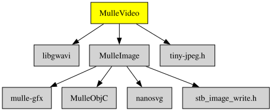

# MulleVideo

Part of [MulleUI](https://github.com/MulleUI) — UIKit-shaped modular GUI libraries for mulle-objc.

#### 🎞️ MulleVideo writes AVI video files from bitmap frames


# MulleUIVideo

#### 🛸 MulleUIVideo does something

It works, sometimes.


| Release Version                                       | Release Notes  | AI Documentation
|-------------------------------------------------------|----------------|---------------
|  [](//github.com/MulleUI/MulleVideo/actions) | [RELEASENOTES](RELEASENOTES.md) | [DeepWiki for MulleVideo](https://deepwiki.com/MulleUI/MulleVideo)


## Documentation & Guides

* [API Summary](asset/dox/api/toc)
* [Coder Guide](asset/howto/coder/mulle-video)
* [Debugger Guide](asset/howto/debugger/mulle-video)
* [Verifier Guide](asset/howto/verifier/mulle-video)


### You are here




## Add

Use [mulle-sde](//github.com/mulle-sde) to add MulleVideo to your project:

``` sh
mulle-sde add github:MulleUI/MulleVideo
```

To only add the sources of MulleVideo with dependency
sources use [clib](https://github.com/clibs/clib):


``` sh
clib install --out src/MulleUI MulleUI/MulleVideo
```

Add `-isystem src/MulleUI` to your `CFLAGS` and compile all the sources that were downloaded with your project.


## Install

Use [mulle-sde](//github.com/mulle-sde) to build and install MulleVideo and all dependencies:

``` sh
mulle-sde install --prefix /usr/local \
   https://github.com/MulleUI/MulleVideo/archive/latest.tar.gz
```

### Legacy Installation

Install the requirements:

| Requirements                                 | Description
|----------------------------------------------|-----------------------
| [libgwavi](https://github.com/MulleUI/libgwavi)             | Even though you can already generate AVI files, this library has not reached a
| [MulleImage](https://github.com/MulleUI/MulleImage)             | 📸 MulleImage defines UIImage and provides some image file formats
| [mulle-objc-list](https://github.com/mulle-objc/mulle-objc-list)             | 📒 Lists mulle-objc runtime information contained in executables.

Download the latest [tar](https://github.com/MulleUI/MulleVideo/archive/refs/tags/latest.tar.gz) or [zip](https://github.com/MulleUI/MulleVideo/archive/refs/tags/latest.zip) archive and unpack it.

Install **MulleVideo** into `/usr/local` with [cmake](https://cmake.org):

``` sh
PREFIX_DIR="/usr/local"
cmake -B build                               \
      -DMULLE_SDK_PATH="${PREFIX_DIR}"       \
      -DCMAKE_INSTALL_PREFIX="${PREFIX_DIR}" \
      -DCMAKE_PREFIX_PATH="${PREFIX_DIR}"    \
      -DCMAKE_BUILD_TYPE=Release &&
cmake --build build --config Release &&
cmake --install build --config Release
```


## Author

[Nat!](https://mulle-kybernetik.com/weblog) for Mulle kybernetiK  


